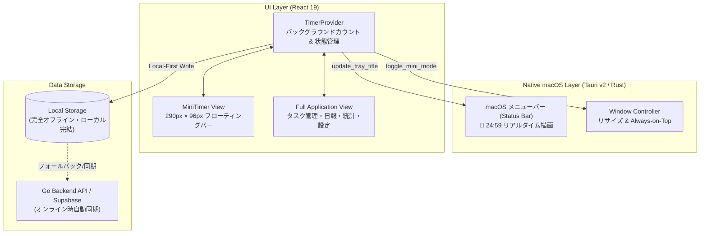

# ADR-0006: ローカル完結 (Local-First) と ミニタイマー常時最前面表示の設計方針

## ステータス
承認 (Accepted)

## コンテキスト
KetchUp Desktop は単なる Web ページのラッパーではなく、「デスクトップアプリだからこその圧倒的な集中体験」を提供することが求められます。
具体的には：
1. **完全ローカル完結（オフライン動作）**:
   インターネット接続や外部クラウド、バックエンド API サーバーの起動有無に関わらず、アプリ単体を起動すればローカルストレージ（LocalStorage / オフラインキュー）によりタスクの追加・タイマーの消化・日報の記録・統計閲覧が即座に動作すること。
2. **macOS 右上（メニューバー / ステータスバー）での常時カウントダウン表示**:
   他アプリで作業中も、macOS の右上メニューバーに「🍅 24:59」や「☕️ 04:59」がリアルタイムに表示され、視線の移動だけで残り時間を確認できること。
3. **ミニタイマー（最前面フロートウィンドウ）モード**:
   フルウィンドウでは作業画面（エディタやブラウザ）を邪魔してしまうため、ワンクリックで「超小型フローティングバー (290px × 96px)」に変形し、`set_always_on_top(true)` で画面の隅に常に浮かせておけること。

## 実装アーキテクチャ

## 意思決定の論理的根拠
1. **Local-First による即時応答性とプライバシー**:
   ポモドーロタイマーやタスク管理は個人の集中ツールであり、ネットワーク遅延や認証サーバーのダウンタイムで作業が止まることは許されません。まずローカルで確実にデータを保持し、サーバーが利用可能な場合に透過的に同期するハイブリッド設計としました。
2. **Rust ネイティブウィンドウ API による Always-on-Top**:
   Web ブラウザの標準 API では「ウィンドウを画面の最前面に固定する」ことは不可能です。Tauri の `window.set_always_on_top(true)` と `window.set_size(LogicalSize)` を利用することで、作業ウィンドウの上に浮かぶ理想的なミニタイマーを実現しました。
3. **AppKit / NSStatusItem 連携**:
   macOS のメニューバー（Status Bar）領域に Rust から直接タイトルを描画することで、最小限のリソース消費で常時秒単位のカウントダウンを実現しました。
