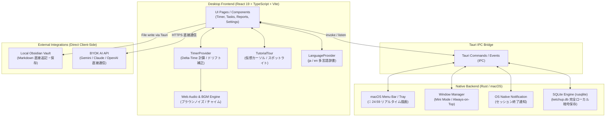
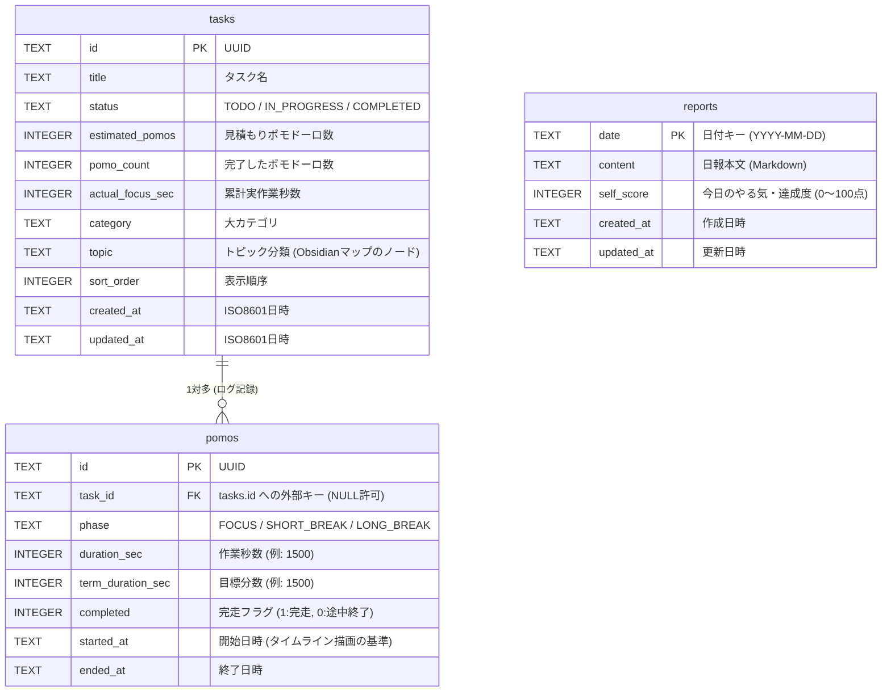

# KetchUp Desktop システムアーキテクチャ & 設計ドキュメント

KetchUp Desktop は、外部サーバー（クラウド）との通信を一切行わない、**完全スタンドアローン・ローカルファースト（Local-First）** の集中・習慣化デスクトップアプリケーションです。

---

## 1. 全体アーキテクチャ図



---

## 2. ディレクトリ構成と各フォルダの役割

```text
ketchup-desktop/
├── apps/
│   └── desktop/                   # デスクトップアプリ本体
│       ├── src/                   # React フロントエンド (UI・状態管理)
│       │   ├── api/               # Rust IPC コール (client.ts) & AI 通信 (ai.ts)
│       │   ├── components/        # 再利用可能な UI コンポーネント群
│       │   │   ├── PomodoroTimer/     # メインタイマー (円形プログレス, ターム選択)
│       │   │   ├── DailyTimelineBar/  # 24時間バーコード集中タイムライン
│       │   │   ├── SimpleTaskList/    # 今日のクイックタスクリスト
│       │   │   ├── TaskList/          # タスク全覧 & Obsidian風ネットワークグラフ
│       │   │   ├── ReportViewer/      # 日報閲覧 & Obsidian 保存 & AI分析
│       │   │   ├── MiniTimer/         # 最前面フローティング・ミニタイマー
│       │   │   └── TutorialTour/      # 10ステップゲーム風チュートリアルツアー
│       │   ├── pages/             # 画面単位のコンポーネント (Timer, Task, Report, Settings等)
│       │   ├── providers/         # グローバル状態管理 (Context)
│       │   │   ├── TimerProvider.tsx      # 【最重要】タイマーロジックの中枢
│       │   │   ├── LanguageProvider.tsx   # 日本語 / 英語 切り替え (i18n)
│       │   │   ├── ThemeProvider.tsx      # テーマ・アクセントカラー管理
│       │   │   ├── TutorialProvider.tsx   # チュートリアルツアーの制御
│       │   │   └── AuthProvider.tsx       # ローカルユーザープロファイル管理
│       │   └── styles/            # グローバルCSS変数 (Vanilla CSS / SCSS)
│       │
│       ├── src-tauri/             # Rust ネイティブバックエンド (OS連携 & DB)
│       │   ├── src/
│       │   │   ├── main.rs        # アプリ起動エントリポイント
│       │   │   ├── lib.rs         # Tauri コマンドハンドラ、トレイ設定、ウィンドウ制御
│       │   │   └── db.rs          # SQLite データベース接続 & クエリ実装 (CRUD)
│       │   ├── icons/             # アプリアイコン & トレイアイコン
│       │   ├── Cargo.toml         # Rust 依存クレート定義 (rusqlite, tauri等)
│       │   └── tauri.conf.json    # ウィンドウ設定・権限・バンドル定義
│       │
│       └── package.json           # フロントエンド依存関係
├── docs/                          # 仕様書・設計書・ドキュメント
└── Makefile                       # 開発・ビルドコマンド集 (make dev, make dmg 等)
```

---

## 3. タイマー計算ロジック（なぜバックグラウンドでもズレないのか）

### ① ドリフト防止（Delta-Time 方式）
ブラウザやデスクトップアプリは、ウィンドウが非アクティブになったり最小化されると、OSの省電力機能によって JavaScript の `setInterval(fn, 1000)` の実行間隔が間引かれます。  
これに対処するため、KetchUp では **「実時間差分（Wall-Clock Time Delta）」** で計算しています：

```ts
// TimerProvider.tsx のロジック概要
const now = Date.now();
const elapsedSec = Math.floor((now - activeFocusStartRef.current) / 1000);
const remaining = Math.max(0, totalDuration - elapsedSec);
setTimeLeft(remaining);
```
- タイマー開始時に `activeFocusStartRef.current = Date.now()` でOSの絶対時刻（ミリ秒）を記録。
- 毎秒タイマーが呼ばれるたびに、「現在時刻 - 開始時刻」を直接引いて残り時間を算出。
- ウィンドウを閉じていたりMacをスリープさせていても、復帰した瞬間に正確な残り時間が計算されます。

### ② 途中停止（Stop）時の正確な秒数集計
ポモドーロ完了（25分完走）だけでなく、途中で作業をやめて停止した場合も、作業した正確な秒数（例: 13分40秒 = 820秒）が SQLite の `pomos` テーブルに即時記録されます。  
これにより、「途中で止めたから記録が消える」という不満を防ぎ、24時間タイムラインに作業実績が正確に積み上がります。

---

## 4. SQLite データベース設計（テーブル構造 & リレーション）

データベースは Mac ローカルの `~/Library/Application Support/com.ketchup.desktop/ketchup.db` に保存されています。



### 結合と集計のロジック
- **タイムライン表示**: `pomos` テーブルの `started_at` と `duration_sec` を読み出し、0時〜24時のどの時間帯に集中していたかをバーコード状にマッピング。
- **タスクごとの累計実績**: ポモドーロ完了時に `pomos` を記録すると同時に、`tasks` テーブルの `pomo_count += 1` および `actual_focus_sec += duration_sec` をアトミックに加算。
- **日報の自動集計**: 今日の日付の `pomos` の `duration_sec` の合計を割り出して「総集中時間」「セッション数」を自動算出し、日報の下書きに反映。

---

## 5. macOS メニューバー（トレイ）連携

- フロントエンド（React）がタイマーをカウントダウンするたび、Tauri の IPC を通じて `invoke('update_tray_title', { title: ' 🍅 24:59' })` を呼び出します。
- Rust 側は `tray.set_title(Some(title))` を使って macOS のステータスバー（画面右上端）に直接描画します。
- これにより、アプリを背面に隠してブラウザやエディタで作業していても、常に視界の隅で残り時間が確認できます。
