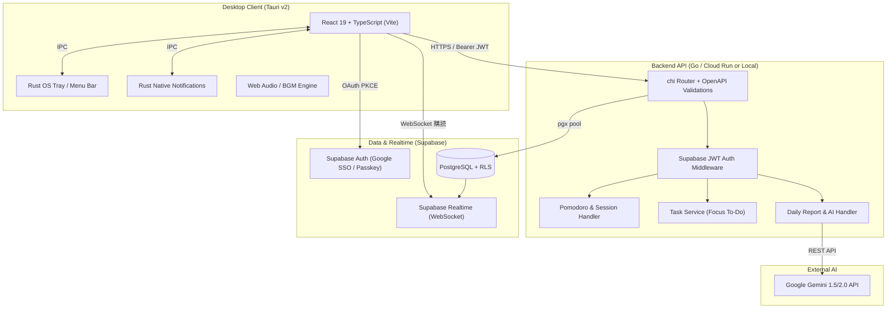

# システムアーキテクチャ

KetchUp Desktop は、堅牢なデスクトップクライアント、高速な Go バックエンド、およびマネージドな Supabase 基盤から成るハイブリッド構成です。



## ディレクトリ構成
```text
ketchup-desktop/
├── apps/
│   └── desktop/               # Tauri v2 + React 19 フロントエンド
│       ├── src/               # React アプリケーション (Pages, Components, Hooks)
│       ├── src-tauri/         # Rust バックエンド (トレイ, 通知, タイマースレッド)
│       └── package.json
├── server/                    # Go API サーバー
│   ├── cmd/server/            # エントリポイント
│   ├── internal/              # ルーター, サービス, リポジトリ, ミドルウェア
│   ├── openapi/               # OpenAPI 仕様書 (Single Source of Truth)
│   └── go.mod
├── supabase/                  # Supabase マイグレーション & 設定
│   └── migrations/
├── docs/                      # 設計書, ADR, セットアップガイド
└── Makefile                   # 開発コマンド集
```
